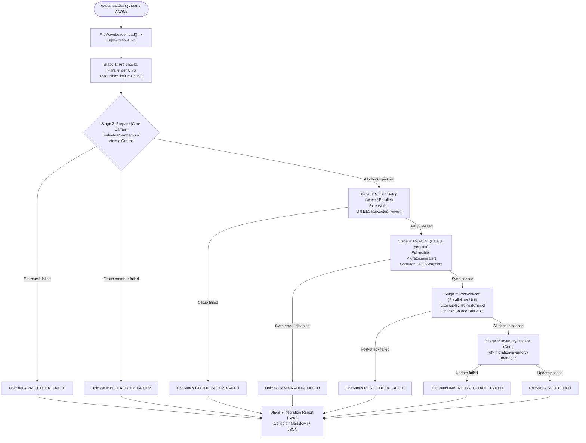
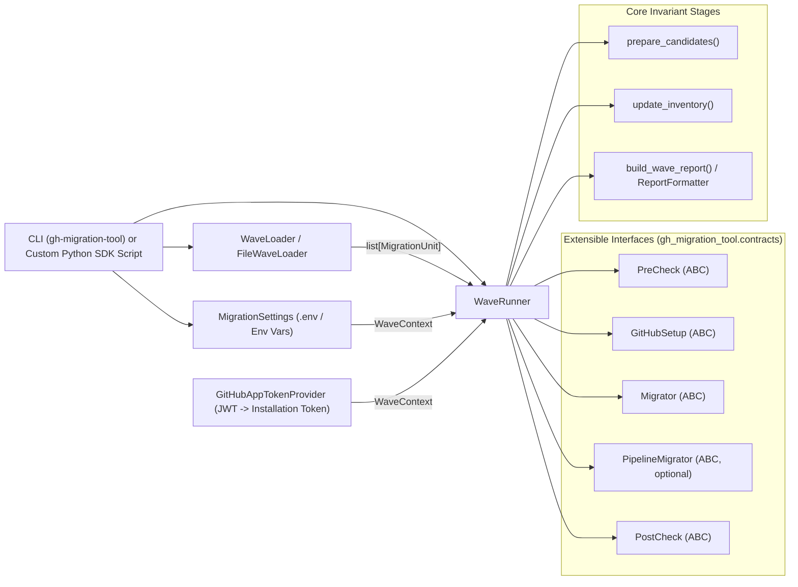

# GitHub Migration Tool (`gh-migration-tool`)

An extensible Python SDK and CLI for orchestrating 7-stage SCM-to-GitHub **Migration Waves** across enterprise engagements.

---

## Table of Contents

- [1. Motivations & Design Philosophy](#1-motivations--design-philosophy)
- [2. Architectural Overview & Extension Mechanisms](#2-architectural-overview--extension-mechanisms)
  - [Wave Execution Lifecycle](#wave-execution-lifecycle)
  - [Component & Extension Architecture](#component--extension-architecture)
  - [Beyond the 7 Stages: Stage-by-Stage Mechanics](#beyond-the-7-stages-stage-by-stage-mechanics)
  - [Why Extend `gh-migration-tool`?](#why-extend-gh-migration-tool)
  - [Extension Mechanisms & Concrete Examples](#extension-mechanisms--concrete-examples)
- [3. Installation, Configuration & Usage](#3-installation-configuration--usage)
  - [Local Installation](#local-installation)
  - [Required Credentials & Integration Setup](#required-credentials--integration-setup)
  - [Environment Variables Reference](#environment-variables-reference)
  - [Wave Manifest Schema & Example](#wave-manifest-schema--example)
  - [Running Locally via CLI](#running-locally-via-cli)
  - [Running as a GitHub Action](#running-as-a-github-action)
- [4. Local Development & Contribution Guide](#4-local-development--contribution-guide)

---

## 1. Motivations & Design Philosophy

Repository migrations at scale rarely fail because of `git push`—they fail because of missing pre-flight readiness checks, uncoordinated coupled applications, untracked commits landing on the origin SCM mid-migration, inconsistent target repository governance, and manual inventory updates.

`gh-migration-tool` addresses these failure modes through four core architectural decisions (documented in [docs/adr/](docs/adr/)):

1. **In-Process Extensible Python SDK over External Script Runner** ([ADR-0001](docs/adr/0001-in-process-extensible-sdk.md)):
   Variable stages (`PreCheck`, `GitHubSetup`, `Migrator`, `PostCheck`) are typed abstract interfaces, while invariant stages (`Prepare`, `Inventory Update`, `Migration Report`) remain concrete core engine steps. Writing customizations as typed Python classes instead of gluing together ad-hoc shell scripts enables unit testing, static type checking, and contributing reusable checks/provisioners back to the core repository.
2. **Deterministic, Stateless Wave Execution** ([ADR-0002](docs/adr/0002-stateless-wave-execution.md)):
   Each Migration Wave executes in-memory from Pre-checks through Migration Report with no local state files or checkpoint databases. If a Migration Unit fails at any stage, it is isolated, marked with a terminal `UnitStatus`, and reported rather than pausing or auto-looping.
3. **Snapshot-Based Source Drift Detection over Commit SHA Parity** ([ADR-0003](docs/adr/0003-snapshot-based-source-drift-detection.md)):
   Because `gh-repo-sync` filters `origin_exclusive_paths`, protects `destination_exclusive_paths` (such as `.github/`), and appends `[skip actions]` to commit messages, destination GitHub commit SHAs intentionally diverge from origin SHAs. Instead of comparing origin vs. destination SHAs, `GitSyncMigrator` captures an in-memory `OriginSnapshot` (branch names and tip SHAs) immediately before syncing, and `SourceDriftPostCheck` verifies that no origin branch advanced or was newly created while migration was in flight.
4. **Strict External Dependency Boundaries** ([ADR-0004](docs/adr/0004-strict-external-dependency-boundaries.md)):
   `gh-migration-tool` integrates with [`gh-repo-sync`](https://github.com/ilegra/gh-repo-sync) (`v1.1.1`) for repository synchronization and [`gh-migration-inventory-manager`](https://github.com/ilegra/gh-migration-inventory-manager) (`v1.3.7`) for Google Sheets inventory tracking strictly through their public domain entrypoints (`SyncConfig`/`SyncManager` and `Inventory.update_progress`).

For canonical domain terminology (`Migration Unit`, `Migration Wave`, `Wave Manifest`, `Candidate`, `Atomic Group`, `Origin Snapshot`, `Source Drift`), see [GLOSSARY.md](GLOSSARY.md).

---

## 2. Architectural Overview & Extension Mechanisms

### Wave Execution Lifecycle

The `WaveRunner` orchestrates a wave through **sequential stage barriers** combined with **parallel per-unit execution** (controlled by `MAX_WORKERS` via `ThreadPoolExecutor`):



### Component & Extension Architecture



### Beyond the 7 Stages: Stage-by-Stage Mechanics

| Stage | Type | Built-in Implementation(s) | Key Behavior |
| :--- | :--- | :--- | :--- |
| **1. Pre-checks** | Extensible (`list[PreCheck]`) | `JenkinsJobPreCheck` | Runs every configured `PreCheck` concurrently per `MigrationUnit`. Exceptions are caught and converted into a failed `CheckResult` so one unit never crashes the wave. |
| **2. Prepare** | Core Invariant | `prepare_candidates()` | Wave-level barrier. Filters units into `Candidates`. If any unit in an `atomic_group` fails a Pre-check, **all** other members of that `atomic_group` are held back with `UnitStatus.BLOCKED_BY_GROUP`. |
| **3. GitHub Setup** | Extensible (`GitHubSetup`) | `GitHubApiSetup`, `VerifyRepoExistsGitHubSetup` | Calls `setup_wave(candidates, context)`. By default, dispatches `setup_unit()` in parallel; subclasses can override `setup_wave()` for bulk IaC/Terraform runs. |
| **4. Migration** | Extensible (`Migrator`) | `GitSyncMigrator` | Captures `OriginSnapshot` via `git ls-remote --heads`, then executes `gh-repo-sync` (`SyncManager.execute()`) in an isolated temp directory with token masking. |
| **4.5. Pipeline Migration (Optional)** | Extensible (`list[PipelineMigrator]`) | — *(consumer-defined)* | Executes optional mutating post-mirroring hooks (e.g., CI/CD pipeline conversion or Jenkins job reconfiguration) sequentially per unit and in parallel across units before Stage 5. |
| **5. Post-checks** | Extensible (`list[PostCheck]`) | `SourceDriftPostCheck`, `JenkinsTriggerPostCheck`, `GitHubActionsTriggerPostCheck` | Receives both `MigrationUnit` and `MigrationStageResult` (including `origin_snapshot`). Verifies no Source Drift occurred and optionally triggers/polls downstream CI. |
| **6. Inventory Update** | Core Invariant | `update_inventory()` | Calls `gh_migration_inventory_manager.Inventory.update_progress()` for each verified unit to record `INVENTORY_TARGET_STATUS` in Google Sheets. |
| **7. Migration Report** | Core Invariant | `build_wave_report()`, `ReportFormatter` | Aggregates every `UnitExecutionRecord` in manifest order into a `WaveReport` and renders `console`, `markdown`, or `json` output. |

### Why Extend `gh-migration-tool`?

Not all migrations are the same:
- **Validations vary**: One engagement may require checking Jenkins job health, while another must verify Jira/ServiceNow change-freeze windows, SonarQube quality gates, or zero open pull requests on GitLab/Bitbucket.
- **Provisioning varies**: Some organizations create repositories, teams, and rulesets dynamically via the GitHub API (`GitHubApiSetup`), while others manage repositories through Terraform/IaC (`VerifyRepoExistsGitHubSetup` or a custom bulk `setup_wave` runner).
- **Sync & verification vary**: Different SCMs, monorepo splitting rules, or downstream deployment webhooks require custom `Migrator` or `PostCheck` logic.

By implementing the typed interfaces in `gh_migration_tool.contracts`, you reuse the core wave orchestration, `Atomic Group` gating, thread-pool concurrency, `GitHubAppTokenProvider`, Google Sheets inventory writeback, and reporting without reimplementing pipeline plumbing.

### Extension Mechanisms & Concrete Examples

> [!IMPORTANT]
> **CLI vs. Python SDK**: The built-in `gh-migration-tool run` CLI uses the default stages (`JenkinsJobPreCheck`, `GitHubApiSetup`, `GitSyncMigrator`, `SourceDriftPostCheck`). To plug in custom `PreCheck`, `GitHubSetup`, `Migrator`, or `PostCheck` implementations, create a Python entrypoint script (example below) that passes your custom instances to `WaveRunner`.

All extension contracts live in `gh_migration_tool.contracts`:
- `PreCheck`: implement `name` (`@property`) and `execute(self, unit: MigrationUnit, context: WaveContext) -> CheckResult`
- `GitHubSetup`: implement `setup_unit(self, unit: MigrationUnit, context: WaveContext) -> SetupResult` (or override `setup_wave(self, candidates: list[MigrationUnit], context: WaveContext) -> dict[str, SetupResult]` for batch provisioning)
- `Migrator`: implement `migrate(self, unit: MigrationUnit, context: WaveContext) -> MigrationStageResult`
- `PostCheck`: implement `name` (`@property`) and `execute(self, unit: MigrationUnit, migration_result: MigrationStageResult, context: WaveContext) -> CheckResult`
- `WaveLoader` (in `gh_migration_tool.contracts`): implement `load(self, source: Path) -> list[MigrationUnit]` if loading manifests from a custom format or API.

#### Example: Custom `PreCheck`, Bulk `GitHubSetup`, `PostCheck`, and Wiring into `WaveRunner`

Save the following as `run_custom_wave.py`:

```python
import sys
from pathlib import Path

from gh_migration_tool import (
    CheckResult,
    FileWaveLoader,
    GitHubActionsTriggerPostCheck,
    GitHubSetup,
    JenkinsJobPreCheck,
    MigrationSettings,
    MigrationStageResult,
    MigrationUnit,
    PostCheck,
    PreCheck,
    ReportFormatter,
    SetupResult,
    SourceDriftPostCheck,
    UnitStatus,
    WaveContext,
    WaveRunner,
)


class FreezeWindowPreCheck(PreCheck):
    """Custom Pre-check reading unit.metadata to enforce a migration freeze flag."""

    @property
    def name(self) -> str:
        return "freeze_window_pre_check"

    def execute(self, unit: MigrationUnit, context: WaveContext) -> CheckResult:
        if unit.metadata.get("freeze_active", False):
            return CheckResult(
                check_name=self.name,
                passed=False,
                message=f"Unit '{unit.name}' is currently in a change-freeze window.",
            )
        return CheckResult(
            check_name=self.name,
            passed=True,
            message="No active change freeze.",
        )


class BulkTerraformGitHubSetup(GitHubSetup):
    """Custom GitHubSetup overriding setup_wave() for batch IaC provisioning."""

    def setup_wave(
        self, candidates: list[MigrationUnit], context: WaveContext
    ) -> dict[str, SetupResult]:
        if not candidates:
            return {}
        # Run your batch IaC / Terraform apply once for all Candidates here...
        return {
            unit.name: SetupResult(
                unit_name=unit.name,
                passed=True,
                message="Provisioned via batch Terraform run.",
                created=False,
            )
            for unit in candidates
        }

    def setup_unit(self, unit: MigrationUnit, context: WaveContext) -> SetupResult:
        raise NotImplementedError("Handled in bulk via setup_wave().")


class SyncStatsPostCheck(PostCheck):
    """Custom Post-check verifying at least one branch was evaluated during Migration."""

    @property
    def name(self) -> str:
        return "sync_stats_post_check"

    def execute(
        self,
        unit: MigrationUnit,
        migration_result: MigrationStageResult,
        context: WaveContext,
    ) -> CheckResult:
        if not migration_result.evaluated_branches:
            return CheckResult(
                check_name=self.name,
                passed=False,
                message="No branches were evaluated during migration.",
            )
        return CheckResult(
            check_name=self.name,
            passed=True,
            message=f"Evaluated {len(migration_result.evaluated_branches)} branch(es).",
        )


def main() -> int:
    manifest_path = Path(sys.argv[1])
    units = FileWaveLoader().load(manifest_path)
    settings = MigrationSettings()

    runner = WaveRunner(
        settings=settings,
        pre_checks=[JenkinsJobPreCheck(), FreezeWindowPreCheck()],
        github_setup=BulkTerraformGitHubSetup(),
        post_checks=[
            SourceDriftPostCheck(),
            SyncStatsPostCheck(),
            GitHubActionsTriggerPostCheck(),
        ],
    )

    report = runner.run(units)
    print(ReportFormatter.to_markdown(report))

    has_failures = any(rec.status != UnitStatus.SUCCEEDED for rec in report.records)
    return 1 if has_failures else 0


if __name__ == "__main__":
    sys.exit(main())
```

Run your custom workflow:

```bash
python run_custom_wave.py wave-manifest.yaml
```

---

## 3. Installation, Configuration & Usage

### Local Installation

**Prerequisites:**
- Python `>=3.10,<3.13`
- `git` CLI installed and available in `PATH`

Install directly from GitHub with `pip`:

```bash
pip install "git+https://github.com/ilegra/gh-migration-tool.git"
```

Or add it to a Poetry project:

```bash
poetry add "git+https://github.com/ilegra/gh-migration-tool.git"
```

Verify the CLI is installed:

```bash
gh-migration-tool --help
```

### Required Credentials & Integration Setup

Because `gh-migration-tool` orchestrates multiple external systems (`gh-repo-sync` for origin-to-GitHub mirroring, GitHub REST API for repository setup & Actions, `gh-migration-inventory-manager` for Google Sheets, and optionally Jenkins), you must configure credentials for each active integration:

#### A. Origin SCM Credentials (Required for `gh-repo-sync` & `SourceDriftPostCheck`)
- `ORIGIN_TOKEN`: Personal Access Token or HTTP access token with read permissions on the origin repositories.
- `ORIGIN_USERNAME`: Optional HTTP Basic Auth username (defaults to `x-token-auth` for Bitbucket Cloud token-only auth, or `x-access-token` otherwise). Leave unset when using Bitbucket Repository/Workspace/Project Access Tokens.
- In your Wave Manifest, set `origin_provider` (e.g., `gitlab`, `bitbucket`, `azure_devops`, `github`) so `gh-repo-sync` selects the right origin provider.

#### B. Target GitHub App Setup (Required for `GitHubSetup`, `GitSyncMigrator`, & `GitHubActionsTriggerPostCheck`)
`gh-migration-tool` authenticates to GitHub using a **GitHub App** (`GitHubAppTokenProvider` signs a short-lived RS256 JWT and exchanges it for an Installation Access Token).
1. Create a GitHub App in your target GitHub Organization (or Enterprise) with at least:
   - **Repository Permissions**: `Administration` (Read & Write — needed by `GitHubApiSetup` for repo creation, visibility, and rulesets), `Contents` (Read & Write — needed by `GitSyncMigrator` to push branches/tags), `Actions` (Read & Write — needed if using `GitHubActionsTriggerPostCheck`), `Metadata` (Read-only).
   - **Organization Permissions**: `Members` (Read & Write — needed if `teams` are configured in `GitHubApiSetup`).
2. Install the GitHub App on the target organization and note the **App ID** (`GITHUB_APP_ID`) and **Installation ID** (`GITHUB_APP_INSTALLATION_ID`).
3. Generate a private key (`.pem`) and provide it via **either**:
   - `GITHUB_APP_PRIVATE_KEY_PATH=/path/to/private-key.pem` (recommended for local runs), **or**
   - `GITHUB_APP_PRIVATE_KEY` containing the PEM string (recommended for CI/CD secrets).
4. For GitHub Enterprise Server, set `GITHUB_API_URL` (e.g., `https://github.example.com/api/v3`).

#### C. Google Sheets Inventory Setup (Required for Stage 6: `update_inventory`)
Stage 6 uses `gh-migration-inventory-manager` to update the migration tracking spreadsheet:
1. In Google Cloud Console, enable the **Google Sheets API**, create a **Service Account**, and download its JSON key file.
2. Share your target Google Spreadsheet with the Service Account's `client_email` as **Editor**.
3. Set `GOOGLE_SPREADSHEET_ID` to the spreadsheet ID from the URL (`https://docs.google.com/spreadsheets/d/<SPREADSHEET_ID>/edit`).
4. Set `GOOGLE_CREDENTIALS_PATH` to the path of the downloaded Service Account JSON key file (if omitted, `gh-migration-inventory-manager` falls back to Google Application Default Credentials).

#### D. Jenkins CI Setup (Optional)
Required only if your units specify `jenkins_job` and you use `JenkinsJobPreCheck` or `JenkinsTriggerPostCheck`:
- `JENKINS_URL`, `JENKINS_USERNAME`, `JENKINS_TOKEN`.

### Environment Variables Reference

Copy [.env.example](.env.example) to `.env` in your working directory (`MigrationSettings` automatically loads `.env`):

```bash
cp .env.example .env
```

| Variable | Required? | Default | Used By | Description |
| :--- | :--- | :--- | :--- | :--- |
| `ORIGIN_TOKEN` | Yes (private origins) | `""` | Stage 4, Stage 5 (`SourceDriftPostCheck`) | Origin SCM access token for `git ls-remote` and `gh-repo-sync`. |
| `ORIGIN_USERNAME` | Conditional | `None` | Stage 4, Stage 5 (`SourceDriftPostCheck`) | Origin SCM username (defaults to `x-token-auth` for Bitbucket Cloud, or `x-access-token` otherwise). |
| `GITHUB_APP_ID` | Yes | `""` | Stages 3, 4, 5 | Numeric GitHub App ID. |
| `GITHUB_APP_INSTALLATION_ID` | Yes | `""` | Stages 3, 4, 5 | GitHub App Installation ID on target org. |
| `GITHUB_APP_PRIVATE_KEY` | Yes (or `_PATH`) | `""` | Stages 3, 4, 5 | GitHub App RSA private key PEM content. |
| `GITHUB_APP_PRIVATE_KEY_PATH` | Yes (or inline key) | `None` | Stages 3, 4, 5 | Path to GitHub App `.pem` private key file. |
| `GITHUB_API_URL` | No | `https://api.github.com` | Stages 3, 5 | GitHub REST API base URL (override for GHES). |
| `GOOGLE_SPREADSHEET_ID` | Yes (Stage 6) | `""` | Stage 6 (`update_inventory`) | Target Google Spreadsheet ID. |
| `GOOGLE_CREDENTIALS_PATH` | Recommended | `None` | Stage 6 (`update_inventory`) | Path to Google Service Account JSON key file. |
| `INVENTORY_TARGET_STATUS` | No | `"migrated"` | Stage 6 (`update_inventory`) | Status written for verified Migration Units. |
| `JENKINS_URL` | Conditional | `""` | `JenkinsJobPreCheck`, `JenkinsTriggerPostCheck` | Base URL of Jenkins controller. |
| `JENKINS_USERNAME` | Conditional | `None` | `JenkinsJobPreCheck`, `JenkinsTriggerPostCheck` | Jenkins username for Basic Auth. |
| `JENKINS_TOKEN` | Conditional | `""` | `JenkinsJobPreCheck`, `JenkinsTriggerPostCheck` | Jenkins API token or Bearer token. |
| `MAX_WORKERS` | No | `4` | `WaveRunner`, `GitHubSetup` | Max concurrent threads for per-unit stages. |
| `CI_POLL_INTERVAL_SECONDS` | No | `5.0` | `JenkinsTriggerPostCheck`, `GitHubActionsTriggerPostCheck` | Interval between CI status polls. |
| `CI_POLL_TIMEOUT_SECONDS` | No | `300.0` | `JenkinsTriggerPostCheck`, `GitHubActionsTriggerPostCheck` | Max wait time for CI completion. |
| `LOG_LEVEL` | No | `"INFO"` | CLI (`gh-migration-tool`) | Standard Python log level (`DEBUG`, `INFO`, `WARNING`, `ERROR`). |

### Wave Manifest Schema & Example

A Wave Manifest can be `.yaml`, `.yml`, or `.json` (either a top-level list of units or an object with a `units:` key).

**`MigrationUnit` fields:**
- **Required**: `name`, `origin_url`, `destination_url`
- **Optional**: `project`, `atomic_group`, `origin_provider`, `branch_mapping` (`dict[str, str]`), `origin_exclusive_paths` (`list[str]`), `destination_exclusive_paths` (`list[str]`), `visibility` (`"private"` | `"internal"` | `"public"`, default `"private"`), `teams` (`dict[str, str]`, e.g. `{"platform-eng": "maintain"}`), `rulesets` (`list[dict]`), `jenkins_job`, `github_workflow`, `metadata` (`dict[str, Any]`).

Example `wave-manifest.yaml`:

```yaml
units:
  - name: payments-api
    project: core-banking
    atomic_group: payments-suite
    origin_provider: gitlab
    origin_url: https://gitlab.example.com/core/payments-api.git
    destination_url: https://github.com/my-org/payments-api.git
    visibility: private
    branch_mapping:
      master: main
    origin_exclusive_paths:
      - .gitlab-ci.yml
    destination_exclusive_paths:
      - .github/
    teams:
      payments-team: maintain
      security-team: pull
    rulesets:
      - name: protect-main
        target: branch
        enforcement: active
        conditions:
          ref_name:
            include: ["refs/heads/main"]
            exclude: []
        rules:
          - type: pull_request
            parameters:
              required_approving_review_count: 1
    jenkins_job: folder/payments-api-build
    github_workflow: ci.yml

  - name: payments-worker
    project: core-banking
    atomic_group: payments-suite
    origin_provider: gitlab
    origin_url: https://gitlab.example.com/core/payments-worker.git
    destination_url: https://github.com/my-org/payments-worker.git
    visibility: private
```

### Running Locally via CLI

```bash
# Run wave and print console report
gh-migration-tool run wave-manifest.yaml

# Run wave and save Markdown report to file
gh-migration-tool run wave-manifest.yaml --format markdown --report-out migration-report.md

# Run wave and save JSON report to file
gh-migration-tool run wave-manifest.yaml --format json --report-out migration-report.json

# Run wave and freeze Bitbucket Cloud origin repositories after Post-checks
gh-migration-tool run wave-manifest.yaml --origin-deactivator bitbucket-cloud
```

> **Note on Origin Deactivation (Step 5.5):** When enabled via `--origin-deactivator bitbucket-cloud` (or `WaveRunner(..., origin_deactivator=BitbucketCloudOriginDeactivator())`), Step 5.5 runs **after `PostCheck`** and **before `Inventory Update`**. By default, `BitbucketCloudOriginDeactivator` adds a `"push"` branch restriction (`pattern: "*"`) so original permissions are preserved for analysis and rollback is straightforward (`ORIGIN_TOKEN` requires `repository:admin` scope). Individual units can opt out in the Wave Manifest with `deactivate_origin: false`. If deactivation fails, the unit is marked `ORIGIN_DEACTIVATION_FAILED` and `Inventory Update` is skipped.

**Exit codes:**
- `0`: All Migration Units reached `UnitStatus.SUCCEEDED`.
- `1`: One or more Migration Units failed in any stage.

### Running as a GitHub Action

Create `.github/workflows/migration-wave.yml` in your operations repository.

**Required Repository/Environment Secrets:**
- `ORIGIN_TOKEN` (and `ORIGIN_USERNAME` if using Bitbucket/Azure DevOps)
- `GITHUB_APP_ID`
- `GITHUB_APP_INSTALLATION_ID`
- `GITHUB_APP_PRIVATE_KEY` (full PEM content of the GitHub App private key)
- `GOOGLE_SPREADSHEET_ID`
- `GOOGLE_CREDENTIALS_JSON` (full JSON content of the Google Service Account key)
- *(Optional, if using Jenkins)* `JENKINS_URL`, `JENKINS_USERNAME`, `JENKINS_TOKEN`

```yaml
name: Run Migration Wave

on:
  workflow_dispatch:
    inputs:
      manifest_path:
        description: "Path to the Wave Manifest YAML/JSON file"
        required: true
        type: string
        default: "waves/wave-01.yaml"
      report_format:
        description: "Report format"
        required: true
        type: choice
        options: ["markdown", "json", "console"]
        default: "markdown"

jobs:
  migrate-wave:
    runs-on: ubuntu-24.04
    steps:
      - name: Checkout Wave Manifests
        uses: actions/checkout@v4

      - name: Set up Python 3.10
        uses: actions/setup-python@v5
        with:
          python-version: "3.10"

      - name: Install gh-migration-tool
        run: |
          python -m pip install --upgrade pip
          pip install "git+https://github.com/ilegra/gh-migration-tool.git"

      - name: Write Google Service Account Credentials
        env:
          GOOGLE_CREDENTIALS_JSON: ${{ secrets.GOOGLE_CREDENTIALS_JSON }}
        run: |
          echo "$GOOGLE_CREDENTIALS_JSON" > "${{ runner.temp }}/google-creds.json"

      - name: Execute Migration Wave
        id: run_wave
        env:
          ORIGIN_TOKEN: ${{ secrets.ORIGIN_TOKEN }}
          ORIGIN_USERNAME: ${{ secrets.ORIGIN_USERNAME }}
          GITHUB_APP_ID: ${{ secrets.GITHUB_APP_ID }}
          GITHUB_APP_INSTALLATION_ID: ${{ secrets.GITHUB_APP_INSTALLATION_ID }}
          GITHUB_APP_PRIVATE_KEY: ${{ secrets.GITHUB_APP_PRIVATE_KEY }}
          GITHUB_API_URL: ${{ vars.GITHUB_API_URL || 'https://api.github.com' }}
          GOOGLE_SPREADSHEET_ID: ${{ secrets.GOOGLE_SPREADSHEET_ID }}
          GOOGLE_CREDENTIALS_PATH: ${{ runner.temp }}/google-creds.json
          INVENTORY_TARGET_STATUS: ${{ vars.INVENTORY_TARGET_STATUS || 'migrated' }}
          JENKINS_URL: ${{ secrets.JENKINS_URL }}
          JENKINS_USERNAME: ${{ secrets.JENKINS_USERNAME }}
          JENKINS_TOKEN: ${{ secrets.JENKINS_TOKEN }}
          MAX_WORKERS: ${{ vars.MAX_WORKERS || '4' }}
          LOG_LEVEL: ${{ vars.LOG_LEVEL || 'INFO' }}
        run: |
          set +e
          gh-migration-tool run "${{ inputs.manifest_path }}" \
            --format "${{ inputs.report_format }}" \
            --report-out "${{ runner.temp }}/migration-report.out"
          EXIT_CODE=$?
          if [ "${{ inputs.report_format }}" = "markdown" ]; then
            cat "${{ runner.temp }}/migration-report.out" >> "$GITHUB_STEP_SUMMARY"
          else
            cat "${{ runner.temp }}/migration-report.out"
          fi
          exit $EXIT_CODE

      - name: Upload Migration Report Artifact
        if: always()
        uses: actions/upload-artifact@v4
        with:
          name: migration-report
          path: ${{ runner.temp }}/migration-report.out
          if-no-files-found: warn
```

---

## 4. Local Development & Contribution Guide

Follow these steps to set up a local development environment and contribute changes:

### Step 1: Prerequisites
Ensure you have:
- Python `3.10`, `3.11`, or `3.12` (`requires-python = ">=3.10,<3.13"`)
- [Poetry](https://python-poetry.org/docs/#installation) (`>=2.0.0`)
- `git`

### Step 2: Fork, Clone, and Create a Feature Branch
Never commit directly to `main`. Use Conventional Branch naming (`feat/<topic>`, `fix/<topic>`, `docs/<topic>`):

```bash
git clone https://github.com/ilegra/gh-migration-tool.git
cd gh-migration-tool
git checkout -b feat/my-new-precheck
```

### Step 3: Install Dependencies & Pre-commit Hooks

```bash
poetry install --with dev
poetry run pre-commit install
```

### Step 4: Run Quality Gates & Tests Locally
All checks below mirror [.github/workflows/ci.yaml](.github/workflows/ci.yaml) and must pass before opening a Pull Request:

```bash
# 1. Lint & formatting
poetry run ruff check src tests
poetry run ruff format --check src tests

# 2. Strict static type checking
poetry run mypy src tests

# 3. Security scan
poetry run bandit -r src

# 4. Unit tests with coverage
poetry run pytest tests/unit -v --cov=gh_migration_tool --cov-report=term-missing

# 5. Integration tests
poetry run pytest tests/integration -v
```

### Step 5: Follow Project Conventions & Open a Pull Request
Before committing, review [AGENTS.md](AGENTS.md) and [GLOSSARY.md](GLOSSARY.md):
- **Pure Data Models**: Keep classes in `models.py` as pure data containers without business logic or logging.
- **Unit Testing Rules** (`tests/unit/`):
  - Tests must be fast, deterministic, and offline (mock all external HTTP/Git/Google API calls).
  - Test exclusively via **public methods** (never invoke `_private` helpers in unit tests).
  - Strictly follow the naming convention: `test_given_<precondition>_when_<action>_then_<outcome>`.
- **Conventional Commits**: Commit logical sequences of passing work using Conventional Commits (e.g., `feat: add SonarQubePreCheck`, `docs: expand architecture guide`).
- **PR Checklist**: Ensure all tests and quality gates pass, no merge conflicts exist, and your branch is up to date with `main`.
